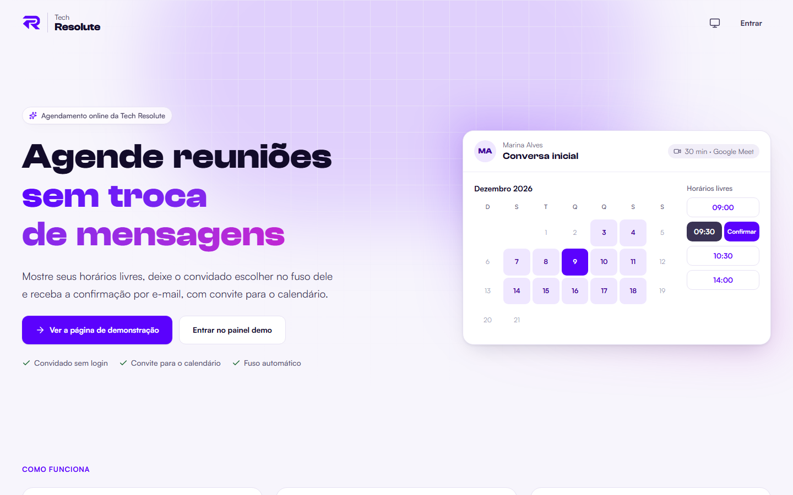
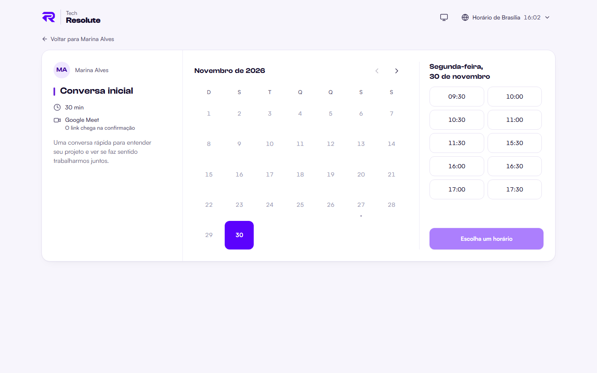
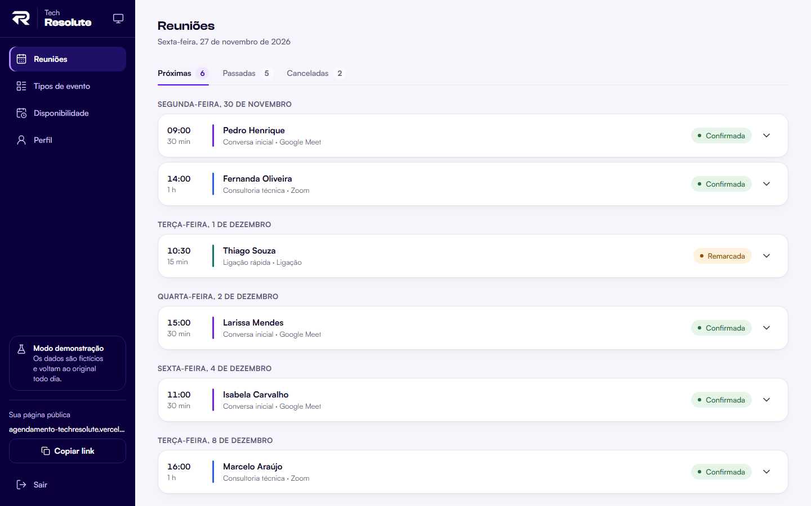

# Agenda Tech Resolute

Sistema de agendamento de reuniões (estilo Calendly) da Tech Resolute. Qualquer pessoa cria conta, define a
disponibilidade e compartilha um link; o convidado escolhe o horário no próprio fuso, sem login, e recebe a
confirmação por e-mail com convite para o calendário.

**[Ver o site no ar](https://agendamento-techresolute.vercel.app)** ·
[página de agendamento demo](https://agendamento-techresolute.vercel.app/marina-demo) ·
[entrar no painel demo](https://agendamento-techresolute.vercel.app/login) (botão "Entrar como anfitrião demo", sem
cadastro; os dados voltam ao original todo dia)

<picture>
  <source media="(prefers-color-scheme: dark)" srcset="docs/screenshots/inicio-dark.png">
  
</picture>

| Convidado escolhendo o horário | Painel do anfitrião |
| --- | --- |
| <picture><source media="(prefers-color-scheme: dark)" srcset="docs/screenshots/agendamento-dark.png"></picture> | <picture><source media="(prefers-color-scheme: dark)" srcset="docs/screenshots/painel-dark.png"></picture> |

Os prints acompanham o tema do GitHub (claro ou escuro), como o próprio app.

## Destaques técnicos

- **Horários calculados por função pura e testada**, com fuso do anfitrião e do convidado e horário de verão.
- **Conflito de reserva impossível no banco:** constraint de exclusão no Postgres, não só checagem no código.
- **Segurança em camadas:** RLS em todas as tabelas, reservas só por funções `security definer`, validação Zod no
  servidor, rate limit por IP e honeypot.
- **Convidado sem conta:** cancela ou remarca por link com token, e o `.ics` atualiza o mesmo evento no calendário.
- **Qualidade:** TypeScript strict, testes unitários, testes de banco em Postgres na memória (PGlite), E2E com
  Playwright em desktop e mobile, e CI no GitHub Actions.
- **Visual:** tema claro e escuro, layout de 320 px a 4K, acessível por teclado e leitor de tela.

## Documentação

- Requisitos e regras de negócio: [docs/REQUISITOS.md](docs/REQUISITOS.md)
- Banco de dados (tabelas, RLS, funções): [docs/BANCO.md](docs/BANCO.md)
- Design (tokens, componentes, acessibilidade): [DESIGN.md](DESIGN.md)
- Vídeos de demonstração (abrem no Chrome, Edge ou VLC): [cliente marcando uma reunião](docs/videos/cliente-como-agendar.webm)
  e [empresa usando o painel](docs/videos/empresa-como-usar.webm)

## Funcionalidades

- **Convidado:** página pública do anfitrião, calendário com horários livres no fuso do convidado, formulário com
  perguntas do evento, confirmação com `.ics`, link seguro para cancelar ou remarcar sem login.
- **Anfitrião:** cadastro e login (senha ou link por e-mail), reuniões por aba, remarcar e cancelar, tipos de evento
  (local, regras, perguntas, cor), disponibilidade semanal com exceções por data, perfil com foto.
- **E-mails** (Resend) para reserva, cancelamento e remarcação, no fuso de quem recebe, com `.ics` que atualiza o
  mesmo evento no calendário.
- **Embed** para outros sites: botão com janela, iframe na página ou link direto (`public/embed.js`).
- **Modo demo** (`/marina-demo`): login em um clique, dados de exemplo protegidos e reset diário.
- **Segurança:** RLS em todas as tabelas, reservas só por funções `security definer`, constraint anti conflito no
  banco, validação Zod no servidor, rate limit e honeypot.
- **LGPD:** aviso no formulário, política de privacidade em `/privacy` e anonimização após 12 meses.

## Stack

Next.js 16 (App Router, Cache Components, `proxy.ts`), React 19, TypeScript strict, Tailwind 4, Supabase
(Postgres, Auth, Storage) com `@supabase/ssr`, Zod 4, React Hook Form, Motion, lucide-react, Resend, Vitest,
Playwright, PGlite (testes de banco).

## Rodando localmente

Requer Node 24 ou superior e um projeto no Supabase.

```bash
npm install
cp .env.example .env.local   # preencha os valores (veja abaixo)
npm run supabase -- login
npm run supabase -- link --project-ref <ref do projeto>
npm run db:push              # aplica as migrations
npm run demo:reset           # cria o anfitrião demo e os dados de exemplo
npm run dev
```

### Variáveis de ambiente

| Variável | Onde pegar |
| --- | --- |
| `NEXT_PUBLIC_SUPABASE_URL`, `NEXT_PUBLIC_SUPABASE_PUBLISHABLE_KEY` | Supabase > Project Settings > API Keys |
| `SUPABASE_SECRET_KEY` | mesma tela, chave secreta (só no servidor) |
| `NEXT_PUBLIC_APP_URL` | `http://localhost:3000` local, URL da Vercel em produção |
| `RESEND_API_KEY`, `EMAIL_FROM` | Resend > API Keys. Sem chave, os e-mails são pulados e registrados no log |
| `RATE_LIMIT_SALT`, `CRON_SECRET` | textos aleatórios de 32+ caracteres (`openssl rand -base64 48`) |
| `DEMO_USER_EMAIL`, `DEMO_USER_PASSWORD` | credenciais do anfitrião demo (senha com 12+ caracteres) |

No Supabase, em **Authentication > URL Configuration**, defina a Site URL como `<NEXT_PUBLIC_APP_URL>` e inclua
`<NEXT_PUBLIC_APP_URL>/auth/callback` nas Redirect URLs. Os e-mails de login (cadastro, link de acesso, recuperação e
troca de e-mail) têm modelos em português: veja [docs/EMAILS-AUTH.md](docs/EMAILS-AUTH.md).

**Limitação do Resend:** sem domínio verificado, os e-mails só chegam ao endereço dono da conta Resend. A reserva
funciona normalmente mesmo quando o envio falha.

## Scripts

| Script | O que faz |
| --- | --- |
| `npm run dev` | servidor de desenvolvimento |
| `npm run build` | build de produção |
| `npm run check` | lint + typecheck + testes unitários e de banco |
| `npm run test` | Vitest (função de slots, e-mails, i18n, validações e banco em PGlite) |
| `npm run test:db` | só os testes de banco (Postgres em memória com as migrations) |
| `npm run test:e2e` | Playwright contra o banco real, desktop e mobile |
| `npm run db:push` / `npm run db:types` | aplica migrations / gera os tipos do banco |
| `npm run demo:reset` | recria o anfitrião demo com datas relativas a hoje |
| `npm run format` | Prettier com ordenação de classes do Tailwind |

**CI:** a cada push na `main` e em cada pull request, o GitHub Actions (`.github/workflows/ci.yml`) roda formatação,
lint, tipos, testes unitários e de banco e o build. Os testes E2E ficam de fora porque precisam do banco real.

**Testes E2E:** usam o perfil demo do banco configurado no `.env.local` e criam reservas de verdade (removidas no
reset do demo). O rate limit permite 5 ações a cada 10 minutos por IP, então espere 10 minutos entre duas execuções
completas.

## Rotinas automáticas (Vercel Cron)

Definidas em [vercel.json](vercel.json) e protegidas por `CRON_SECRET`:

| Rota | Horário (UTC) | O que faz |
| --- | --- | --- |
| `/api/cron/demo-reset` | 06:00 | recria os dados do demo (RN-72) |
| `/api/cron/maintenance` | 06:30 | anonimiza convidados de reuniões com mais de 12 meses e limpa o rate limit (RN-65) |

## Deploy (Vercel)

A produção acompanha a branch `main`: cada push gera um deploy novo.

1. Importe o repositório na Vercel e cadastre as variáveis da tabela acima. As três `NEXT_PUBLIC_` precisam ser do
   tipo **Config** (a Vercel não aceita `NEXT_PUBLIC_` como Secret); as demais ficam como **Secret**.
2. `NEXT_PUBLIC_APP_URL` é a URL do site, sem barra no final. Variáveis `NEXT_PUBLIC_` entram no build, então depois
   de mudar qualquer uma é preciso fazer **Redeploy**.
3. No Supabase, atualize a Site URL e as Redirect URLs para a URL de produção.
4. Para os e-mails de login, ative o SMTP do Resend no Supabase (**Authentication > Emails > SMTP Settings**: host
   `smtp.resend.com`, porta `465`, usuário `resend`, senha igual à `RESEND_API_KEY`).

## Embed

Código pronto no painel, em **Tipos de evento > Incorporar no seu site**. Exemplo em `/embed-example.html`.

```html
<!-- Botão com janela -->
<script src="https://SEU-APP/embed.js" data-url="https://SEU-APP/usuario/evento" data-label="Agendar conversa" async></script>

<!-- Na página -->
<div data-techresolute-inline="https://SEU-APP/usuario/evento"></div>
<script src="https://SEU-APP/embed.js" async></script>
```

Quando a reserva é concluída, a página recebe o evento `techresolute:booking-confirmed` em `window`.

## Estrutura

```
app/                 rotas: perfil público, agendamento, /booking/[token], /dashboard, login, APIs e crons
components/          booking (fluxo do convidado), manage, dashboard, auth, ui, brand
lib/scheduling/      função pura de geração de horários (fuso e horário de verão)
lib/booking/         queries públicas, Server Actions, schemas, erros
lib/dashboard/       queries, Server Actions e schemas do painel
lib/email/           templates, montagem e envio (Resend)
lib/auth/            sessão (Data Access Layer) e actions de login
lib/i18n/            dicionários pt-BR e en (mesmas chaves, testado)
public/embed.js      script de incorporação
supabase/migrations/ schema, RLS, funções, demo, grants
tests/               unit e db (Vitest)
e2e/                 Playwright
```
